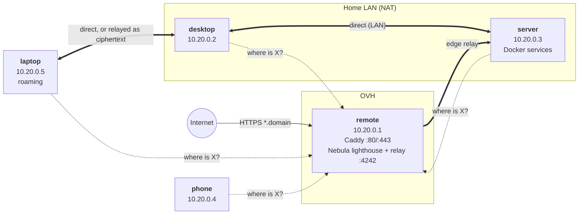
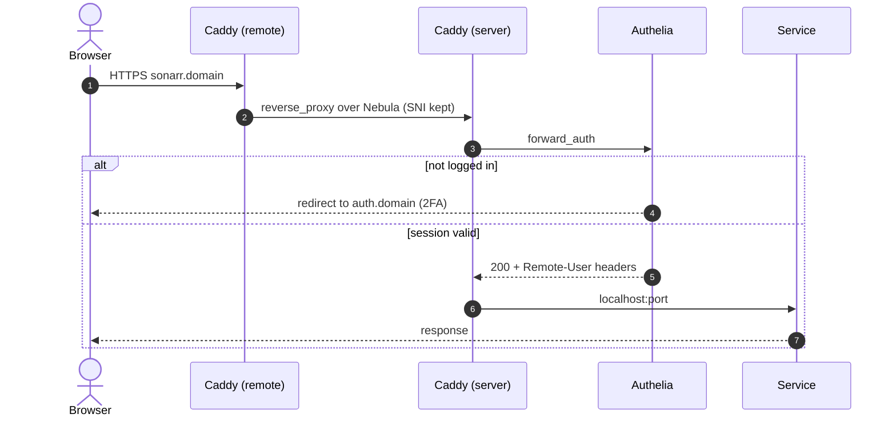
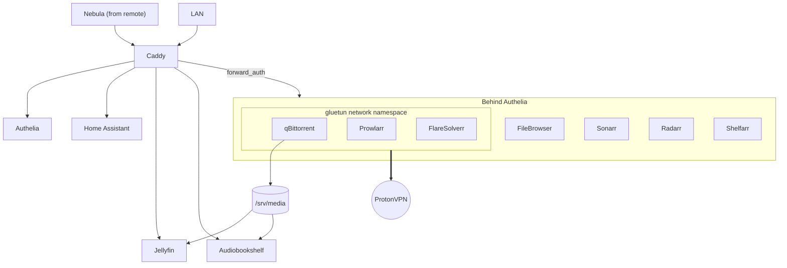
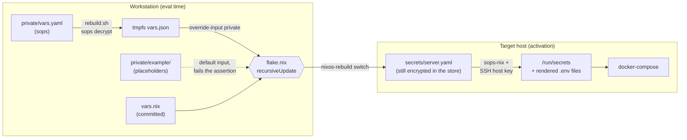

# nixos

[](https://github.com/LeVraiBaptiste/nixos/actions/workflows/ci.yml)

My NixOS flake: two workstations, a home server and a public gateway, tied together
with a Nebula mesh. Secrets go through sops-nix, and personal values (domain, public IP,
identities) stay encrypted so the repo can be public.

## Hosts

| Host      | Role                                                                             |
|-----------|----------------------------------------------------------------------------------|
| `desktop` | Workstation: GNOME, nvidia, Steam, OBS, DaVinci Resolve, local Whisper dictation |
| `laptop`  | Lighter workstation (no nvidia, Steam or dictation server)                       |
| `server`  | Home server (Dell T330): Home Assistant, Jellyfin, media stack, Authelia         |
| `remote`  | Public gateway: Nebula lighthouse, Caddy ingress, installed with disko           |

`desktop` and `laptop` use home-manager; `server` and `remote` are deployed over SSH
from a workstation.

## Network

`remote` has the only public IP. Every machine joins a Nebula mesh (`10.20.0.0/24`):
`remote` is the lighthouse (it tells peers where to find each other) and a relay of last
resort, but each pair of hosts gets its own end-to-end tunnel, direct on the LAN at home.
The home server stays behind NAT with no port forwarded.



## Request path

Public traffic for `*.<domain>` hits Caddy on `remote` (Let's Encrypt), which relays it
through the tunnel to a second Caddy on `server` (`tls internal`). That one routes by
host, and puts Authelia in front of the services that have no login of their own.



## Server services

Everything runs from one `docker-compose.yml`, rendered by Nix with the ports from
`vars.nix`. The download side shares gluetun's network namespace, so it only reaches the
internet through ProtonVPN.



## Layout

```
flake.nix         Entry point, one nixosConfiguration per host
hosts/<host>/     default.nix + hardware-configuration.nix
modules/nixos/    System modules (boot, network, gnome, nvidia, docker, edge, ...)
modules/home/     Home-manager modules (git, fish, neovim, tmux, ghostty, ...)
config/           Dotfiles and service configs (nvim, tmux, docker-compose, Caddyfile)
overlays/         Package overlays
scripts/          Rebuild, dictation, backups, IPMI fan control
vars.nix          Shared non-secret values (LAN/Nebula IPs and groups, ports)
private/          Personal values, sops-encrypted (see below)
secrets/          sops-encrypted secrets for the server
docs/             Architecture, Nebula setup, secrets
nebula/           Nebula CA and host certificates (public)
```

## Secrets and personal values

Two kinds of data stay out of the clear:

- **Secrets** (`secrets/server.yaml`): passwords, keys, tokens. sops-nix decrypts them on
  the target host at activation into `/run/secrets`, so they never land in the Nix store.
- **Personal values** (`private/vars.yaml`): domain, public IP, git identities, emails.
  They are needed at evaluation time, so `scripts/rebuild.sh` decrypts them into a tmpfs
  directory and passes it as `--override-input private`.



The default `private` input is `private/example/vars.json`, which only holds placeholders
(`example.com`, `203.0.113.10`). A host built with it fails an assertion instead of
deploying them. Recipients and recovery are described in [docs/secrets.md](docs/secrets.md).

## Usage

```sh
scripts/rebuild.sh            # current host (fish alias: rebuild)
scripts/rebuild.sh server     # deploy over SSH
scripts/rebuild-all.sh        # current host, then server, then remote
```

A plain `nixos-rebuild` uses the placeholders and stops on the assertion.

## Reusing it

This is a personal config, not a framework, but parts of it can be lifted as they are.
To build it on your own machines:

1. Replace `hosts/*/hardware-configuration.nix` with your own (`nixos-generate-config`).
2. Create an age key (`age-keygen -o ~/.config/sops/age/keys.txt`) and put its public key
   in `.sops.yaml` in place of mine.
3. Write your own `private/vars.yaml` from `private/example/vars.json` and encrypt it
   (`sops -e -i private/vars.yaml`). Do the same for `secrets/server.yaml` if you use the
   server.
4. Adjust `vars.nix` (IPs) and the user name in the modules, then create your Nebula CA
   and certificates (`docs/nebula-setup.md`) in place of mine.

## CI

CI never sees a key: hosts are evaluated with the placeholder values (the guard lifted,
see `scripts/ci/eval-host.sh`), and nothing is built.

| Workflow | When | What |
|----------|------|------|
| [`ci.yml`](.github/workflows/ci.yml) | push, PR | nixfmt, statix, deadnix; gitleaks over the whole history; sops files really encrypted; every host evaluates |
| [`update.yml`](.github/workflows/update.yml) | weekly | PR updating `flake.lock`, with the package changes per host; PR bumping `orca-ide` with nix-update |
| [`vulnix.yml`](.github/workflows/vulnix.yml) | weekly | vulnix scan of every host's runtime closure, kept in an issue labelled `vulnix` (informative, never blocking) |

Dependabot keeps the actions up to date.

## Pre-commit hook

`scripts/check-private-leaks.sh` decrypts `private/vars.yaml` and refuses a commit whose
staged changes contain one of its values. CI can't do this check since it never has the
values. Enable it once per clone:

```sh
git config core.hooksPath .githooks
git config blame.ignoreRevsFile .git-blame-ignore-revs   # skip the formatting commit in blame
```
