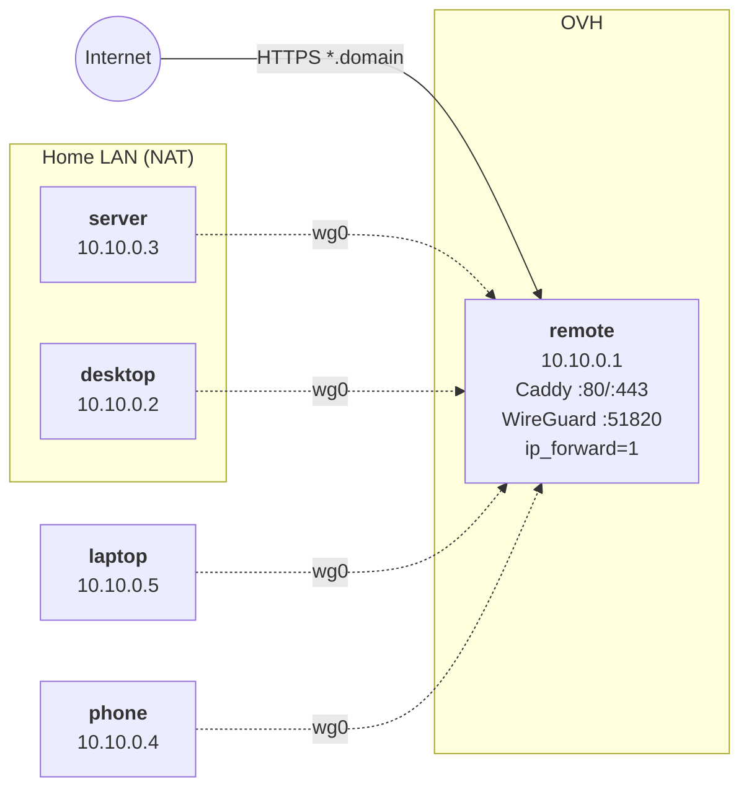
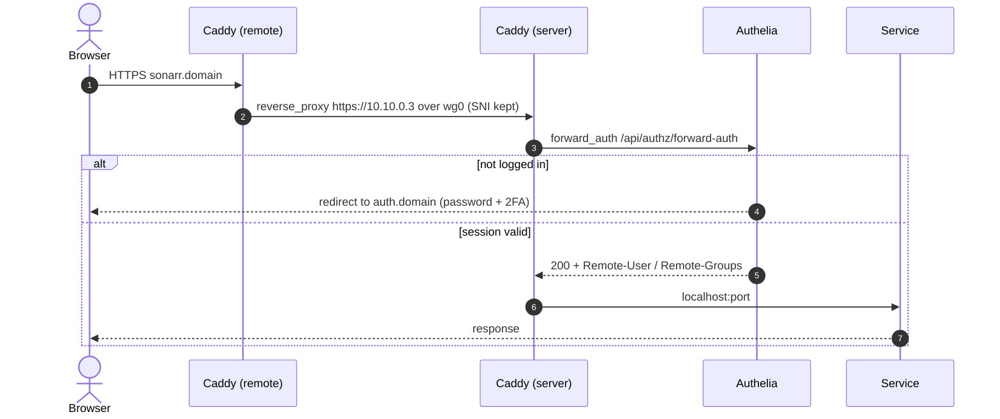
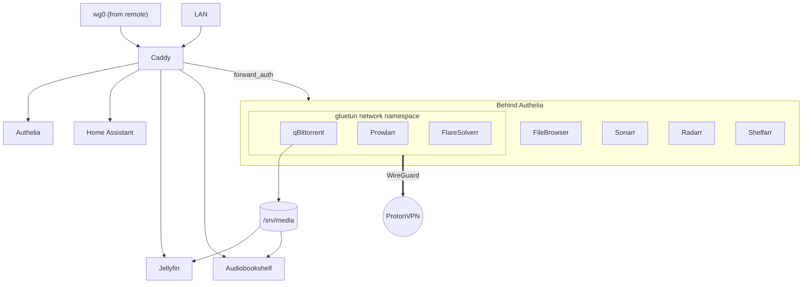
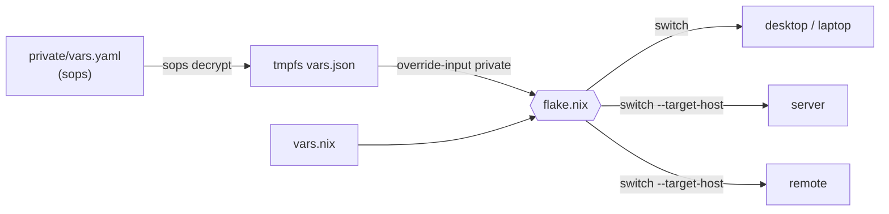

# Homelab Architecture

## Overview

Four NixOS hosts in one flake, joined by a WireGuard star centred on `remote`:

| Host      | Where            | Role                                                        |
|-----------|------------------|-------------------------------------------------------------|
| `remote`  | OVH, public IP   | WireGuard hub, public ingress (native Caddy, Let's Encrypt) |
| `server`  | Home LAN, NAT    | Dell T330, every self-hosted service (one docker-compose)   |
| `desktop` | Home LAN, NAT    | Workstation, deploys the two machines above over SSH        |
| `laptop`  | Anywhere         | Roaming workstation, reaches the others through the tunnel  |

Nothing at home is exposed: `remote` is the only machine with an open port on the
internet, and the server is reached through a tunnel it opens itself.

## Network



- `remote` runs WireGuard through systemd-networkd, with one peer per host (`/32`
  allowed IPs) and IP forwarding, so peers reach each other through it.
- Every other host is a client with `persistentKeepalive = 25` (they are all behind NAT)
  and a split tunnel: only `10.10.0.0/24` goes through `wg0`.
- On `server`, `wg0` is a trusted firewall interface. On `desktop`, only Orca's port
  (`6768`) is opened on `wg0`, for the phone.

Tunnel IPs, the listen port and public keys live in `vars.nix`. Key generation and the
phone setup are in [wireguard-setup.md](wireguard-setup.md).

## Ingress

There are two Caddy instances:

- **Edge** (`remote`, `modules/nixos/edge.nix`): native NixOS Caddy, owns 80/443 and gets
  real certificates. It declares one virtual host per server subdomain and relays it to
  `https://10.10.0.3`, keeping the original `Host` and SNI. A catch-all on `:80`
  aborts requests for undeclared hosts; on 443 they fail the TLS handshake.
- **Server** (`config/server/Caddyfile`, in docker-compose): `tls internal`, routes by
  host to `localhost:<port>`, and trusts `X-Forwarded-*` only from `10.10.0.1`. The edge
  skips verification of its internal certificate.



| Subdomain    | Service        | Auth                       |
|--------------|----------------|----------------------------|
| `auth`       | Authelia       | portal itself              |
| `assistant`  | Home Assistant | own login (also plain HTTP on the LAN, for the Android app) |
| `medias`     | Jellyfin       | own login                  |
| `audiobooks` | Audiobookshelf | own login                  |
| `files`      | FileBrowser    | Authelia                   |
| `torrents`   | qBittorrent    | Authelia                   |
| `prowlarr`   | Prowlarr       | Authelia                   |
| `sonarr`     | Sonarr         | Authelia                   |
| `radarr`     | Radarr         | Authelia                   |
| `shelfarr`   | Shelfarr       | Authelia                   |

Adding a subdomain means touching both sides: `serverSubdomains` in `edge.nix` and a
block in the server's Caddyfile. Apps hosted on `remote` itself just add their own
`services.caddy.virtualHosts`.

## Server services



Most containers use host networking. qBittorrent, Prowlarr and FlareSolverr use
`network_mode: service:gluetun` instead, so their only way out is gluetun's ProtonVPN
tunnel (if it drops, they lose the internet rather than leaking).

### How compose is deployed

`modules/nixos/docker-compose.nix` defines `homelab.compose.files`. The server host fills
it with `config/server/*` templates passed through `pkgs.replaceVars` (domain, ports,
timezone from `vars`), and the module links them into `/etc/docker-compose`. A
`docker-compose` systemd unit runs `docker compose -p homelab up -d --remove-orphans`
and restarts whenever one of the files changes, so `rebuild server` is the only
deployment step.

Secrets never go through the templates: sops-nix renders `authelia.env`,
`gluetun.env` and `authelia-users.yml` into `/run/secrets/rendered/`, which compose
mounts by absolute path. Each template restarts `docker-compose.service` when it
changes. See [secrets.md](secrets.md).

### Other server units

- `ipmi-fan-control`: adjusts the T330's fans to the CPU temperature through IPMI, and
  hands control back to the firmware when stopped.
- `ha-config-backup` (daily timer): commits `/srv/hass/config` and pushes it to a separate
  private `ha-config` repo with a deploy key in `/root/.ssh/ha-deploy-key`. The repo,
  its `.gitignore` (database, `.storage/`, `secrets.yaml`) and the key are bootstrapped
  by hand once.

## Deployment



Everything goes through `scripts/rebuild.sh` from a workstation: it decrypts the personal
values and evaluates the flake locally, then switches the current host or pushes the
closure over SSH. `server` and `remote` have no copy of the repo to build from. A build
with the committed placeholders (`private/example/`) fails an assertion.

`remote` is partitioned with disko and boots GRUB in removable EFI mode, plus a copy to
`\EFI\debian\grubx64.efi`, the only path the OVH firmware reliably boots.

## Data layout (server)

```
/srv/
  hass/config/          Home Assistant (git-tracked, pushed daily)
  caddy/data/           internal CA, state
  authelia/data/        sessions, storage (users file comes from /run/secrets)
  jellyfin/config/
  filebrowser/{data,database,config}/
  gluetun/  qbittorrent/  prowlarr/  sonarr/  radarr/  shelfarr/
  audiobookshelf/{config,metadata}/
  media/
    downloads/  tv/  movies/  ebooks/  audiobooks/
```

The directories are created by `systemd.tmpfiles` in `hosts/server/default.nix`.

## Key decisions

| Decision | Rationale |
|----------|-----------|
| Hub on a rented server, clients dial out | No port forwarding at home; the home IP never matters |
| Two Caddys (edge + server) | The edge only relays and holds the public certificates; routing and auth stay next to the services, and also work on the LAN |
| Authelia on the server, not the edge | Same portal from the LAN and from outside; the edge has no state |
| Plain docker-compose rendered by Nix | Upstream images and compose syntax as documented, still deployed by `nixos-rebuild` alone |
| Download stack inside gluetun | Kill switch by construction: no route out except the VPN |
| HA Container over HA OS / Supervised | Supervised conflicts with NixOS; add-ons are just more containers |
| sops-nix for secrets | Encrypted in the public repo, decrypted on the host with its SSH key, never in the store |
| Separate repo for HA config | Different lifecycle; keeps auto-commits out of this repo |
| WireGuard over OpenVPN | In-kernel, simpler, faster |
