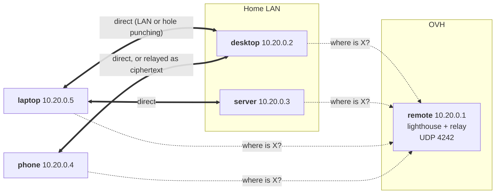

# Nebula Setup

Every host joins one Nebula network, `homelab` (`10.20.0.0/24`). Each pair of hosts
gets its own end-to-end tunnel: `remote` is only the lighthouse (it tells peers where to
find each other) and a relay of last resort, and it never sees cleartext. At home, hosts
talk directly on the LAN.



## How it fits together

| Piece | Where | Role |
|-------|-------|------|
| `vars.nebula` | `vars.nix` | Port, home LAN range, and each host's IP and groups |
| `modules/nixos/nebula.nix` | imported by every host | Lighthouse/relay on `remote`, static map to its public IP elsewhere, firewall |
| `homelab.nebula.inbound` | `hosts/<host>/default.nix` | What this host accepts, by certificate group |
| `scripts/nebula-cert.sh` | workstation | Creates the CA, signs host certificates |
| `nebula/*.crt` | repo (committed) | CA and host certificates, public |
| `~/.config/nebula/ca.key` | workstation only | CA key, passphrase-encrypted |
| `/etc/nebula/homelab.key` | each host | That host's private key, generated in place |

The lighthouse address comes from `vars.remote.ipv4` (`private/vars.yaml`): its public
IP without the prefix length, port `vars.nebula.port`. Every host listens on that fixed
port (the NixOS module opens it in the firewall), so LAN peers reach each other directly.

## Trust model

- **CA key**: on a workstation only, never in the repo, never on a host. Whoever holds
  it can join as any host, with any IP and groups.
- **Host keys**: generated on each host, never leave it.
- **Certificates**: public. They bind a key to a name, an IP and groups.
- **Access control**: Nebula's firewall, by certificate group, per host. ICMP is always
  allowed; everything else must be listed in `homelab.nebula.inbound`. The
  `nebula.homelab` interface is trusted by iptables, so iptables does not filter twice.

A compromised `remote` can drop or delay traffic, and see who talks to whom, but it
cannot read it nor impersonate a host: it has no CA key to sign one.

Groups in use:

| Group | Hosts | Gets |
|-------|-------|------|
| `lighthouse` | remote | the server's 443 (edge relay) |
| `workstation` | desktop, laptop | SSH, the server's 443, dictation on the desktop (8080, 11434) |
| `server` | server | nothing inbound on the others |
| `phone` | phone | Orca on the desktop (6768) |

## Setup from scratch

### 0. Prerequisites

- `remote` installed and reachable over SSH on its public IP, with `vars.remote.ipv4`
  set in `private/vars.yaml`.
- UDP `4242` reachable on `remote` from the internet (OVH: no extra network firewall).
- On the workstation: the sops age key (to decrypt `private/`), `nix`, `jq`.

### 1. Declare the hosts

In `vars.nix`, give each host an IP in `10.20.0.0/24` and its groups:

```nix
nebula = {
  port = 4242;
  lan = "192.168.1.0/24";   # home LAN, preferred when two peers are both at home
  hosts = {
    remote  = { ip = "10.20.0.1"; groups = [ "lighthouse" ]; };
    desktop = { ip = "10.20.0.2"; groups = [ "workstation" ]; };
    # ...
  };
};
```

The host named `remote` is the lighthouse. Import `modules/nixos/nebula.nix` in every
host, and list its inbound rules:

```nix
homelab.nebula.inbound = [
  { port = 22; proto = "tcp"; group = "workstation"; }
];
```

Deploy once (`rebuild`, `rebuild server`, `rebuild remote`): without certificates the
mesh stays disabled (evaluation warning `nebula/<host>.crt missing`), but `nebula-cert`
gets installed on each host for the next step.

### 2. Create the CA (once)

```sh
scripts/nebula-cert.sh init
```

It asks for a passphrase, writes `~/.config/nebula/ca.{key,crt}`, and copies and stages
`nebula/ca.crt`. Back up `ca.key` and the passphrase offline: losing them means
re-enrolling every host under a new CA.

The CA uses v1 certificates (IPv4 only, understood by every client including Mobile
Nebula) and lasts 10 years.

### 3. Enroll each host

Start with `remote`: the others need the lighthouse to find each other away from home.

On the host, generate its key (for `server` and `remote`, over SSH):

```sh
sudo mkdir -p /etc/nebula
sudo nebula-cert keygen -out-key /etc/nebula/homelab.key -out-pub /tmp/homelab.pub
sudo cat /tmp/homelab.pub && sudo rm /tmp/homelab.pub
```

From the workstation for a remote host, in one go:

```sh
ssh server 'sudo mkdir -p /etc/nebula && sudo nebula-cert keygen -out-key /etc/nebula/homelab.key -out-pub /tmp/homelab.pub && sudo cat /tmp/homelab.pub && sudo rm /tmp/homelab.pub' > server.pub
```

`keygen` refuses to overwrite an existing key: if it already ran, only export the public
key. On the workstation, sign it:

```sh
scripts/nebula-cert.sh sign server server.pub
```

This reads the IP and groups from `vars.nebula.hosts.server`, writes and stages
`nebula/server.crt` (flakes only see tracked files), and a QR code `nebula/server.png`
(not committed). The `.pub` file can then be deleted.

### 4. Deploy

```sh
git commit -m "feat(nebula): enroll server"
rebuild-all        # or: rebuild, rebuild server, rebuild remote
```

`remote` first if it is deployed separately. Each host starts `nebula@homelab`.

### 5. Phone (Mobile Nebula)

1. In the app, add a site: it generates a key pair. Copy the public key to the
   workstation (`phone.pub`).
2. `scripts/nebula-cert.sh sign phone phone.pub`
3. In the app:
   - **Certificate**: scan `nebula/phone.png` (or paste `nebula/phone.crt`)
   - **CA**: paste `nebula/ca.crt`
   - **Hosts**: add `10.20.0.1`, lighthouse, with `<remote public IP>:4242`
4. Enable the relay through `10.20.0.1` (advanced settings, or import a YAML config with
   `relay.relays: [10.20.0.1]`): on mobile networks, hole punching often fails.

Android runs one VPN at a time: Mobile Nebula must be the only one active.

The phone is not a NixOS host: committing `nebula/phone.crt` changes nothing to deploy,
but the desktop already accepts it on 6768 (`group = "phone"`).

### 6. Verify

```sh
systemctl status nebula@homelab
ping 10.20.0.1                                # lighthouse
ping 10.20.0.3                                # a peer, e.g. from the laptop
nebula-cert print -path nebula/server.crt     # name, IP, groups, expiry
```

At home, a peer should be reached on its `192.168.1.0/24` address, not the public IP:
`journalctl -u nebula@homelab | grep -i handshake` shows the address used for each peer.

The SSH aliases (`modules/home/ssh.nix`) point to the Nebula IPs, so the first
`ssh desktop` / `ssh server` asks to accept the host key again for that address: check
the fingerprint against `ssh-keyscan` on the LAN address.

## Adding a host later

1. Add it to `vars.nebula.hosts` (next free IP, its groups) and import the module.
2. If others should accept it, add its group to their `homelab.nebula.inbound`.
3. Steps 3 and 4 above for that host, then redeploy the hosts whose rules changed.

## Changing groups or IP

Groups and IP are baked into the certificate: edit `vars.nebula`, then sign the host
again. If its `.pub` is gone, generate a new key on the host (`sudo rm
/etc/nebula/homelab.key`, then step 3), and redeploy.

## Revoking a host

Remove it from `vars.nebula.hosts`, delete `nebula/<host>.crt`, and add its certificate
fingerprint (`nebula-cert print -path nebula/<host>.crt`, before deleting it) to
`pki.blocklist` in the module's `settings`, then redeploy every host. If the CA key
itself leaks, create a new CA and re-enroll everyone.

## Troubleshooting

| Symptom | Check |
|---------|-------|
| Warning `nebula/<host>.crt missing` | Certificate not signed, or not staged (`git add`) |
| Service fails on the key | `/etc/nebula/homelab.key` exists, group `nebula-homelab`, mode 0640 (set by tmpfiles at activation) |
| Nothing reachable away from home | `ping 10.20.0.1`; UDP 4242 open on `remote`; `vars.remote.ipv4` correct |
| Peer reachable but a port is not | Its `homelab.nebula.inbound` lacks the port or the group |
| High latency between two home hosts | Handshake went through the public IP or the relay: check `preferred_ranges` and the logs |
| `Host key verification failed` on an SSH alias | New address for a known host: accept the key after checking its fingerprint |
