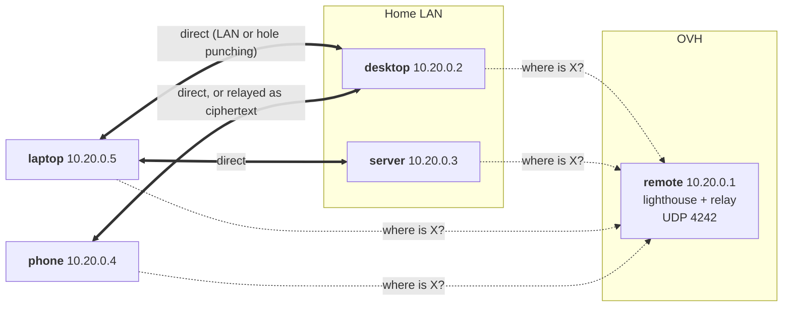

# Nebula Setup

Nebula replaced the WireGuard star. Every pair of hosts gets its own end-to-end tunnel:
`remote` is only the lighthouse (it tells peers where to find each other) and a relay
of last resort, and it never sees cleartext. At home, hosts talk directly on the LAN.



## Trust model

- **CA key**: on a workstation only (`~/.config/nebula/ca.key`, passphrase-encrypted),
  never in the repo, never on a host. Whoever holds it can join as any host.
- **Host keys**: generated on each host (`/etc/nebula/homelab.key`), never leave it.
- **Certificates** (`nebula/*.crt`): public, committed. They bind a key to a name, an
  IP and groups (`vars.nebula.hosts`).
- **Access control**: Nebula's firewall, by certificate group, per host
  (`homelab.nebula.inbound`). The `nebula.homelab` interface is trusted by iptables.

A compromised `remote` can drop or delay traffic, and see who talks to whom, but it
cannot read it nor impersonate a host: it has no CA key to sign one.

## 1. Create the CA (once)

```sh
scripts/nebula-cert.sh init
```

Choose a passphrase, then back up `~/.config/nebula/ca.key` and the passphrase offline.

## 2. Enroll each host

On the host (for `server` and `remote`, over SSH):

```sh
sudo mkdir -p /etc/nebula
sudo nebula-cert keygen -out-key /etc/nebula/homelab.key -out-pub /tmp/homelab.pub
cat /tmp/homelab.pub
```

`nebula-cert` is installed by `modules/nixos/nebula.nix` even before the host has a
certificate. On the workstation, save the public key and sign it:

```sh
scripts/nebula-cert.sh sign server server.pub   # writes and stages nebula/server.crt
```

Until `nebula/<host>.crt` exists, the mesh stays disabled on that host (evaluation
warning). Then deploy: `rebuild`, `rebuild server`, `rebuild remote`.

## 3. Phone (Mobile Nebula)

1. In the app, add a site: it generates a key pair. Copy the public key to the workstation.
2. `scripts/nebula-cert.sh sign phone phone.pub`
3. In the app:
   - **Certificate**: scan `nebula/phone.png` (or paste `nebula/phone.crt`)
   - **CA**: paste `nebula/ca.crt`
   - **Hosts**: add `10.20.0.1`, lighthouse, with `<remote public IP>:4242`
4. Enable the relay through `10.20.0.1` (advanced settings, or import a YAML config with
   `relay.relays: [10.20.0.1]`): on mobile networks, hole punching often fails.

Android runs one VPN at a time: remove the old WireGuard app.

## 4. Verify

```sh
ping 10.20.0.3                                # from the laptop
nebula-cert print -path nebula/server.crt     # name, IP, groups, expiry
```

At home, a peer should be reached on its `192.168.1.0/24` address, not the public IP:
`journalctl -u nebula@homelab | grep -i handshake` shows the address used for each peer.

## Renewal

Host certificates expire with the CA (10 years). Changing a host's groups or IP in
`vars.nebula` means signing it again (`sign`, same public key), then redeploying.
